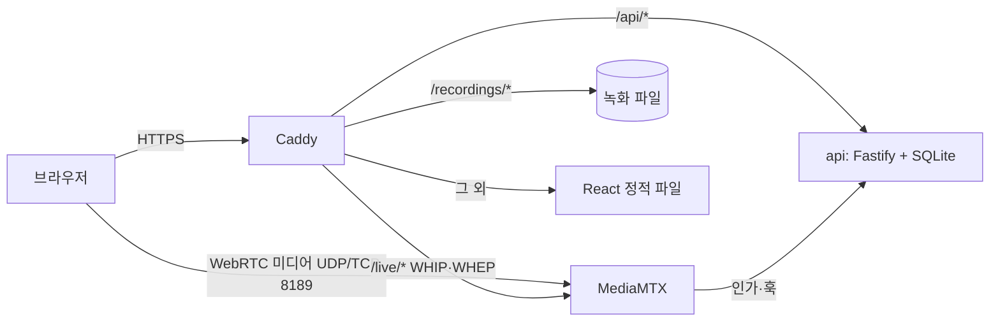

# galle LIVE — 실시간 방송 플랫폼

PC 화면 공유(탭·시스템 소리 + 마이크)와 휴대폰 카메라로 라이브 방송을 송출하고, 로그인 없이 다른 기기에서 실시간으로 시청하는 웹 서비스입니다.
실시간 채팅, 토스페이먼츠 테스트 결제 후원, 녹화·다시보기를 함께 제공합니다.

## 서비스 주소
**https://galle.cloud**

- 별도 설치 없이 브라우저로 접속합니다. 시청은 로그인 없이 됩니다.
- 송출은 HTTPS가 필요합니다(카메라·마이크·화면 공유 권한). 위 주소는 HTTPS입니다.

## 테스트 계정
| 역할 | 이메일 | 비밀번호 |
|---|---|---|
| 방송자 A | `streamer@test.com` | `test1234!` |
| 시청자 B | `viewer@test.com` | `test1234!` |

- **바로 로그인**: 로그인 화면 상단의 `방송자 A` / `시청자 B` 버튼을 누르면 입력 없이 로그인됩니다.
- 새 계정도 회원가입으로 바로 만들 수 있습니다(가입 즉시 로그인, 채널 자동 생성).
- 권한 확인은 브라우저 두 개(또는 일반 창 + 시크릿 창)에 각각 A, B로 로그인하면 편합니다.

## 기능 확인

### 1. PC 방송 (화면 공유 + 탭·시스템 소리 + 마이크)
1. PC Chrome 또는 Edge에서 **방송자 A**로 로그인합니다.
2. 오른쪽 위 `● 방송하기` → 제목 입력 → `만들기`. 방송 상세 화면이 열립니다(상태: 방송 준비).
3. `방송 시작하기` → **방송 스튜디오**로 이동합니다.
4. `🖥 화면 공유`를 누르고 공유할 대상을 고릅니다.
   - **탭 소리**: "Chrome 탭"을 고르고 아래 **"탭 오디오도 공유"**를 켭니다.
   - **시스템 소리**(Windows): "전체 화면"을 고르고 **"시스템 오디오 공유"**를 켭니다.
   - 마이크 권한 창이 뜨면 허용합니다. 화면 아래에 `화면 소리: 포함됨`, `마이크: 켜짐`이 보이면 둘 다 함께 송출됩니다(음량 조절 가능).
5. 미리보기를 확인하고 `방송 시작` → 상태가 **LIVE**로 바뀝니다. 송출 품질(해상도·fps·kbps)과 시청자 수가 표시됩니다.
6. 종료는 스튜디오의 `방송 종료` → 확인. 송출이 끊기고 화면 공유·마이크가 모두 꺼지며, 시청자 화면은 즉시 "방송 종료"로 바뀝니다.

> 방송 중 화면 공유를 브라우저의 "공유 중지"로 멈추면 송출(마이크 포함)이 멈추고 "화면 다시 선택 / 카메라로 전환" 안내가 뜹니다. 45초 안에 다시 선택하지 않으면 방송이 자동 종료됩니다.

### 2. 모바일 방송 (카메라 + 마이크)
1. 휴대폰(iOS Safari, Android Chrome)으로 접속해 로그인 → `● 방송하기` → 제목 입력 → `만들기` → `방송 시작하기`.
2. `📷 카메라` → 카메라·마이크 권한 허용 → 미리보기 확인 → `방송 시작`.
3. 방송 중 `🔄 전면/후면 전환`으로 카메라를 바꿀 수 있습니다(시청자 연결은 끊기지 않습니다).
4. 종료는 `방송 종료`. 송출 중에는 화면을 켜 두세요(앱을 전환하면 휴대폰이 카메라를 멈출 수 있습니다).

### 3. 시청 (다른 기기, 로그인 불필요)
1. 다른 기기(PC↔휴대폰)에서 https://galle.cloud 접속 → 홈의 **지금 방송 중**에서 방송을 고릅니다.
2. 자동재생 정책 때문에 **음소거로 시작**합니다. `🔇 소리 켜기`를 누르면 소리가 나옵니다. `⛶ 전체 화면`도 있습니다.
3. 방송자가 종료하면 새로고침 없이 "방송 종료"로 바뀝니다. 방송자의 네트워크가 잠깐 끊기면 "다시 연결되기를 기다리는 중…"이 보이고, 45초 안에 재연결되면 이어서 재생됩니다.

### 4. 방송 관리 (등록·조회·수정·삭제, 상태)
- **등록**: `방송하기` → 제목(필수, 100자)·설명(선택).
- **조회**: 홈(지금 방송 중 / 다시보기 / 방송 예정), 방송 상세, 채널 화면(`내 채널`).
- **수정**: 방송 상세의 `정보 수정`(방송 중에도 가능, 시청자 화면에 실시간 반영).
- **삭제**: 방송 상세의 `삭제`. 방송 중에는 삭제할 수 없습니다(버튼 비활성, 서버도 409).
- **상태**: `방송 준비 → LIVE → 방송 종료`. 종료된 방송은 다시 송출할 수 없습니다(서버가 거절).
- **영구 저장**: SQLite 파일(도커 볼륨)에 저장되어 서버를 재시작해도 그대로 조회됩니다.

### 5. 권한 확인 (비로그인 / 다른 사용자 / 소유자)
| 해 볼 것 | 비로그인 | 시청자 B (다른 사용자) | 방송자 A (소유자) |
|---|---|---|---|
| 방송 목록·상세·시청 | ✅ | ✅ | ✅ |
| `방송하기` (방송 등록) | 로그인 화면으로 이동 → 로그인 후 복귀 | ✅ (본인 채널) | ✅ |
| A의 방송 `정보 수정`·`삭제`·`방송 시작하기` | 버튼 없음 | 버튼 없음, 주소로 직접 가도 "본인 방송만…" | ✅ |
| A의 방송 스튜디오 주소(`/broadcasts/{id}/studio`) 직접 접속 | 로그인 화면으로 이동 | "본인 방송만 송출할 수 있습니다" | ✅ |
| 채팅 작성 / 남의 채팅 수정·삭제 | "로그인하고 채팅하기" / — | ✅ / 버튼 없음(서버 403) | ✅ / 버튼 없음(서버 403) |
| 후원 | "로그인하고 후원하기" | ✅ (A가 방송 중일 때) | 본인 방송은 불가 |

화면에서 버튼을 숨기는 것과 별개로 **서버가 모든 요청을 다시 검증합니다**(비로그인 401, 다른 사용자 403). 브라우저 개발자 도구에서 API를 직접 호출해도 같습니다. 모든 쓰기 API × 세 사용자 경우를 `apps/api/test/authz-matrix.test.ts`가 검증합니다.

### 6. 선택 기능
- **실시간 채팅**: 방송 화면 오른쪽(휴대폰은 영상 아래). 로그인하면 작성, 내 채팅만 수정·삭제(삭제하면 "삭제된 댓글입니다"). 다른 화면에 새로고침 없이 나타납니다.
- **후원(토스페이먼츠 테스트 결제)**: 다른 사람의 **방송 중** 화면에서 `후원하기` → 금액(1,000원~1,000,000원, 1,000원 단위)·메시지 → 결제창.
  - 테스트 키라 **실제로 결제되지 않습니다**(결제창 상단 "테스트 환경이에요" 표시). 카드 결제는 테스트 환경에서도 카드사 인증 화면을 거칩니다.
  - 완료되면 방송으로 돌아오고, 시청 중인 모든 화면에 후원 알림이 뜨며 방송별 **후원 내역과 합계**가 갱신됩니다.
  - 서버는 저장된 주문 금액·후원 대상을 대조하고 토스 승인 API 응답(상태·금액·주문번호)을 다시 확인한 뒤 적립합니다. 같은 승인 통지가 반복돼도 한 번만 적립됩니다.
- **녹화·다시보기**: 방송은 자동으로 녹화됩니다. 종료 후 홈의 **다시보기** 또는 방송 상세에서 재생합니다(재연결로 구간이 나뉘면 이어서 재생). 녹화 처리에 수십 초가 걸릴 수 있습니다.

## 지원 환경
| 기능 | 환경 |
|---|---|
| PC 화면 공유 + 탭 소리 | Chrome·Edge (Windows·macOS), "Chrome 탭" 공유 |
| PC 화면 공유 + 시스템 소리 | Chrome·Edge (Windows), "전체 화면" 공유 |
| PC 화면 공유 (소리 없음) | 최신 Chrome·Edge·Firefox·Safari |
| 모바일 카메라 송출 | iOS Safari 16.4+, Android Chrome |
| 시청 | 최신 Chrome·Edge·Safari·Firefox (PC·모바일) |
| 다시보기 | 위 브라우저 (H.264 + AAC MP4) |

- macOS는 브라우저가 시스템 전체 소리를 공유하지 못합니다. 탭 소리를 쓰세요.
- 휴대폰 브라우저는 화면 공유를 지원하지 않아 카메라로 송출합니다(화면에서 안내).
- 회사·학교망처럼 UDP가 막힌 네트워크는 TCP 8189로 자동 전환됩니다.

## 실행 방법

### Docker로 전체 실행 (권장)
요구 사항: Docker (Compose v2)

```bash
cp .env.example .env      # INTERNAL_SECRET을 임의 값(영문·숫자 16자 이상)으로 바꾼다
docker compose up -d --build
```
- https://localhost 접속 (로컬 인증서 경고는 무시하고 진행). 테스트 계정은 자동으로 만들어집니다.
- 휴대폰으로 로컬 테스트를 하려면 `.env`의 `SITE_ADDRESS`·`MEDIA_PUBLIC_HOST`에 PC의 LAN IP를 넣습니다(`.env.example` 설명 참고).

### 환경변수 (`.env`)
| 이름 | 필수 | 설명 | 예 |
|---|---|---|---|
| `INTERNAL_SECRET` | ✅ | MediaMTX ↔ api 내부 호출 검증 시크릿(영문·숫자·`-_`, 16자 이상) | `openssl rand -hex 24` 결과 |
| `SITE_ADDRESS` | | Caddy가 응답할 주소 | `localhost` / `galle.cloud` |
| `WWW_ADDRESS` | | www 리다이렉트 주소 | `www.localhost` |
| `MEDIA_PUBLIC_HOST` | | 브라우저가 WebRTC 미디어(8189)를 보낼 주소 | `127.0.0.1` / PC LAN IP / `galle.cloud` |
| `TOSS_CLIENT_KEY`, `TOSS_SECRET_KEY` | | 토스 결제창형 **테스트** 키(`test_gck_…`/`test_gsk_…`). 비우면 후원이 꺼집니다 | — |
| `SEED_TEST_ACCOUNTS` | | 테스트 계정 자동 생성·바로 로그인 (compose 기본 `true`) | `true` |
| `LOG_LEVEL`, `COOKIE_SECURE`, `SESSION_TTL_DAYS`, `IMAGE_TAG` | | 기타 (`.env.example` 참고) | |

실제 키·시크릿은 저장소에 넣지 않습니다(`.env`는 `.gitignore`).

### 개발 모드
요구 사항: Node.js 22 이상

```bash
npm install
npm run dev:api   # http://localhost:3000
npm run dev:web   # http://localhost:5173 (/api는 3000으로 프록시)
npm test          # API 통합 테스트
npm run typecheck # 타입·빌드·CSS 검사
```
- 송출·시청까지 개발 서버로 확인하려면 docker compose를 함께 띄우고 `API_PROXY_TARGET=https://localhost npm run dev:web`.
- DB 마이그레이션은 api 기동 시 자동 적용됩니다.

### 브라우저 E2E (선택)
설치된 Chrome과 가짜 카메라·마이크·화면으로 실제 송출·시청을 자동 확인합니다.
```bash
E2E_BASE_URL=https://localhost npm run e2e        # 전체 (docker compose 실행 중)
E2E_BASE_URL=https://localhost npm run e2e -- 07  # 방송 스튜디오만
```

## 구성


| 디렉터리 | 내용 |
|---|---|
| `apps/api` | Fastify + TypeScript + SQLite(Drizzle). 인증, 방송, 송출 인가·상태 머신, SSE, 채팅, 후원, 녹화 |
| `apps/web` | React + Vite + TypeScript. 방송 스튜디오(WHIP 송출), 시청 플레이어(WHEP), 채팅·후원·다시보기 |
| `infra/caddy` | 리버스 프록시·자동 HTTPS, 정적 파일·녹화 파일 서빙 |
| `infra/mediamtx` | WebRTC 미디어 서버 설정, 훅 스크립트(상태 통지·녹화 변환) |
| `e2e` | 브라우저 E2E 시나리오 |
| `compose.yaml` | 로컬과 운영에서 동일하게 쓰는 구성 |

## 설계 문서
- [docs/DESIGN.md](docs/DESIGN.md): 아키텍처, 방송 상태 머신, 인증·인가와 권한 매트릭스, 선택 기능 설계
- [docs/SPEC_CHECKLIST.md](docs/SPEC_CHECKLIST.md): 명세 항목별 구현·검증 근거
- [docs/WORKLOG.md](docs/WORKLOG.md): 이슈별 설계 판단·코드 리뷰 반영·검증 기록
- [docs/INFRA_SETUP.md](docs/INFRA_SETUP.md): 운영 서버 구성과 배포
- [docs/spikes/2-webrtc.md](docs/spikes/2-webrtc.md): WebRTC 송출·시청·녹화 기술 검증
- [docs/WORKFLOW.md](docs/WORKFLOW.md), [docs/ROADMAP.md](docs/ROADMAP.md), [docs/QUESTIONS.md](docs/QUESTIONS.md)

## 오픈소스와 참고 자료
| 이름 | 용도 | 라이선스 |
|---|---|---|
| [MediaMTX](https://github.com/bluenviron/mediamtx) | WebRTC(WHIP/WHEP) 미디어 서버, 녹화 | MIT |
| [Caddy](https://github.com/caddyserver/caddy) | 리버스 프록시, 자동 HTTPS | Apache-2.0 |
| [FFmpeg](https://ffmpeg.org/) (MediaMTX 이미지 포함) | 녹화 파일 오디오 변환(AAC) | LGPL/GPL |
| [Fastify](https://fastify.dev/), [Drizzle ORM](https://orm.drizzle.team/), [zod](https://zod.dev/), [better-sqlite3](https://github.com/WiseLibs/better-sqlite3), [@node-rs/argon2](https://github.com/napi-rs/node-rs) | API 서버 | MIT |
| [React](https://react.dev/), [React Router](https://reactrouter.com/), [Vite](https://vite.dev/) | 웹 | MIT |
| [토스페이먼츠 결제위젯 SDK v2](https://docs.tosspayments.com/) | 테스트 결제 | 토스페이먼츠 이용약관 |
| [Playwright](https://playwright.dev/) (playwright-core) | 브라우저 E2E | Apache-2.0 |

- WHIP·WHEP 클라이언트는 표준(RFC 9725, draft-ietf-wish-whep)을 보고 직접 구현했습니다(`apps/web/src/lib/webrtc/whip.ts`).
- 그 밖의 의존성과 버전은 각 `package.json`에 있습니다.
- 개발에는 AI 도구(Claude Code)를 사용했습니다. 이슈별 설계 판단과 리뷰 기록은 [docs/WORKLOG.md](docs/WORKLOG.md)에 있습니다.
