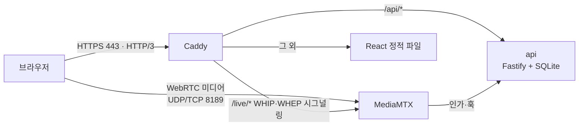

# 인프라 구성과 운영

`https://galle.cloud`는 Oracle Cloud Always Free VM 한 대에서 docker compose로 운영한다. 인프라 비용은 0원이다.
이 문서는 인프라를 처음부터 다시 구성하거나 운영할 때 따르는 절차다. 각 단계 끝의 **✅ 확인**을 통과한 뒤 다음 단계로 넘어간다.

## 1. 구성



| 항목 | 값 |
|---|---|
| 클라우드 | Oracle Cloud Infrastructure, 도쿄 리전(`ap-tokyo-1`) |
| 인스턴스 | `VM.Standard.E2.1.Micro` (x86_64, 1GB), Ubuntu 24.04, 부트 볼륨 100GB |
| 도메인 | `galle.cloud`, `www.galle.cloud` (A 레코드 → 인스턴스 공인 IP) |
| TLS | Caddy 자동 HTTPS (Let's Encrypt) |
| 이미지 | GitHub Actions → GHCR (`linux/amd64`, `linux/arm64`) |

### 원칙
- **이미지는 CI에서 빌드하고 서버는 pull만 한다.** 서버 사양이 바뀌어도(예: A1 이전) 유지한다. 배포가 서버 자원과 상태에 영향을 받지 않고, 같은 이미지를 로컬과 서버에서 재현할 수 있다.
- **외부에 여는 포트는 최소로 한다.** 80/443(Caddy)과 8189(WebRTC 미디어)만 연다. MediaMTX의 Control API(9997)와 WHIP/WHEP(8889)는 Docker 내부 네트워크에서만 접근한다.
- **시크릿은 서버의 `.env`에만 둔다.** 저장소에는 `.env.example`만 올리고, 이미지에는 `.dockerignore`로 `.env`를 넣지 않는다.

## 2. 전제와 제약

| 항목 | 확실도 | 비고 |
|---|---|---|
| 홈 리전은 가입 후 변경할 수 없고, Always Free 리소스는 홈 리전에서만 만들 수 있다 | 확실 | |
| `VM.Standard.E2.1.Micro` 2대가 무료다 | 확실 | 콘솔에 "상시 무료 적격" 표시가 붙는다 |
| ARM `VM.Standard.A1.Flex`는 합계 4 OCPU / 24GB까지 무료지만 용량 부족으로 생성이 자주 실패한다 | 확인됨 | 도쿄 리전은 가용성 도메인이 하나뿐이라 다른 AD로 우회할 수 없다. 그래서 Micro로도 동작하게 설계했다 |
| 아웃바운드 전송은 월 10TB까지 무료다 | 높음 | 공식 무료 티어 페이지 기준 |
| 무료 계정에서 사용률이 낮은 Always Free 인스턴스는 회수될 수 있다 | 중간 | §8 참고 |
| 인스턴스를 중지했다 시작해도 공인 IP는 유지되고, 삭제 후 다시 만들면 바뀐다 | 중간 | 바뀌면 DNS A 레코드를 갱신한다 |

## 3. OCI 리소스

> 2026-11 기준 콘솔 UI다. 리소스 상세 화면의 하위 메뉴는 페이지 상단 탭(세부정보 · 서브넷 · 보안 · 게이트웨이 …)으로 표시된다.

### 3-1. 예산 알림
**청구 및 비용 관리 → 예산 → 예산 생성**: 루트 구획, 월 예산 $1, 알림 임계값 1%.
무료 범위를 벗어나는 리소스가 생기면 바로 알 수 있다.

### 3-2. VCN
**네트워킹 → 가상 클라우드 네트워크 → VCN 마법사 시작 → "인터넷 접속을 통한 VCN 생성"**
- 이름 `live-vcn`, CIDR은 기본값(`10.0.0.0/16`, 퍼블릭 서브넷 `10.0.0.0/24`)을 쓴다. compose 네트워크(`10.89.0.0/24`)와 겹치지 않는다.
- 마법사 없이 VCN을 직접 만들면 서브넷과 인터넷 게이트웨이가 없어서, 공인 IP가 있어도 인터넷에 연결되지 않는다.

### 3-3. Security List
`live-vcn` → **보안** 탭 → 퍼블릭 서브넷에 연결된 보안 목록 → **보안 규칙** → **수신 규칙 추가**

| 소스 CIDR | 프로토콜 | 대상 포트 | 용도 |
|---|---|---|---|
| 0.0.0.0/0 | TCP | 80 | HTTP (인증서 발급, HTTPS 리다이렉트) |
| 0.0.0.0/0 | TCP | 443 | HTTPS |
| 0.0.0.0/0 | UDP | 443 | HTTP/3 |
| 0.0.0.0/0 | UDP | 8189 | WebRTC 미디어 |
| 0.0.0.0/0 | TCP | 8189 | WebRTC 미디어 (UDP가 막힌 네트워크용 ICE-TCP 폴백) |

- 소스 포트 범위는 비운다(전체). 소스 포트는 클라이언트가 임의로 고르는 번호다.
- SSH(22)는 기본 규칙으로 열려 있고, 이미지가 키 인증만 허용한다.

### 3-4. 인스턴스
**컴퓨트 → 인스턴스 → 인스턴스 생성**

| 항목 | 값 |
|---|---|
| 이미지 | Canonical Ubuntu 24.04 |
| 셰이프 | `VM.Standard.A1.Flex`를 먼저 시도하고, 용량이 부족하면 `VM.Standard.E2.1.Micro` |
| 보안 | 실드된 인스턴스, 기밀 컴퓨팅 사용 안 함 |
| 네트워킹 | `live-vcn`의 퍼블릭 서브넷, 공용 IPv4 주소 자동 할당 |
| SSH 키 | 로컬에서 만든 공개키를 붙여넣는다 (`ssh-keygen -t ed25519`) |
| 부트 볼륨 | 100GB, VPU 기본값(10). 녹화가 시간당 약 1.1GB를 쓰므로 기본 47GB로는 부족하다. 무료 한도는 합계 200GB |

- 셰이프에 "상시 무료 적격" 표시가 있는지 확인한다. 같은 목록의 `VM.Standard.E2.1`(8GB)은 이름이 비슷하지만 유료다.
- A1은 생성 후 **작업 → 셰이프 편집**으로 OCPU와 메모리를 늘릴 수 있다.

✅ 확인: 인스턴스가 **실행 중**이고 공용 IP가 표시된다.

## 4. 서버 초기 설정

로컬 `~/.ssh/config`에 별칭을 등록해 두면 `ssh live`로 접속할 수 있다.
```
Host live
  HostName <공인IP>
  User ubuntu
  IdentityFile ~/.ssh/<개인키>
```

### 4-1. 사양 확인
```bash
uname -m; free -h; df -h /; lsb_release -d
```
E2.1.Micro 기준: `x86_64`, 메모리 약 950Mi, `/` 약 96G(부트 볼륨이 첫 부팅 때 자동 확장됨), Ubuntu 24.04.
메모리가 8GB로 나오면 유료 셰이프로 만든 것이다.

### 4-2. 패키지, 시간대, 스왑
```bash
sudo apt update && sudo apt -y upgrade
sudo timedatectl set-timezone Asia/Seoul

# 1GB 인스턴스에서는 이미지 pull과 컨테이너 기동이 겹치면 메모리를 넘을 수 있다
sudo fallocate -l 2G /swapfile && sudo chmod 600 /swapfile
sudo mkswap /swapfile && sudo swapon /swapfile
echo '/swapfile none swap sw 0 0' | sudo tee -a /etc/fstab

# 스왑은 비상용으로만 쓴다
echo 'vm.swappiness=10' | sudo tee /etc/sysctl.d/99-swappiness.conf
sudo sysctl --system > /dev/null
```
- `/var/run/reboot-required`가 있으면 재부팅한다.
- 메모리가 6GB 이상인 셰이프에서는 스왑을 생략해도 된다.

### 4-3. OS 방화벽
OCI의 Ubuntu 이미지는 iptables에서 22번 외의 모든 포트를 막은 상태로 시작한다. Security List와 별개로 여기서도 열어야 한다.
```bash
sudo iptables -I INPUT -p tcp -m multiport --dports 80,443,8189 -j ACCEPT
sudo iptables -I INPUT -p udp -m multiport --dports 443,8189 -j ACCEPT
sudo netfilter-persistent save   # 없으면 sudo apt install -y iptables-persistent
sudo iptables -L INPUT -n --line-numbers | head -10   # ACCEPT가 REJECT보다 위에 있어야 한다
```

포트가 외부에서 열렸는지는 그 포트를 듣는 프로세스를 잠시 띄워 확인한다.
```bash
sudo python3 -m http.server 80   # 로컬에서 http://<공인IP> 접속 후 Ctrl+C
```

### 4-4. Docker
```bash
curl -fsSL https://get.docker.com | sudo sh
sudo usermod -aG docker ubuntu
# 컨테이너 로그가 디스크를 채우지 않도록 크기를 제한한다
printf '{\n  "log-driver": "json-file",\n  "log-opts": { "max-size": "10m", "max-file": "3" }\n}\n' | sudo tee /etc/docker/daemon.json
sudo systemctl restart docker
```
다시 접속해 docker 그룹을 적용한 뒤 확인한다.
```bash
docker run --rm hello-world && docker compose version
```

✅ 확인: `hello-world`가 출력되고, `free -h`에 스왑 2.0Gi가 보이고, 외부에서 80번 포트에 접속된다.

## 5. DNS와 HTTPS

도메인 등록업체의 DNS 설정에서 A 레코드를 인스턴스 공인 IP로 지정한다.

| 타입 | 호스트 | 값 | TTL |
|---|---|---|---|
| A | `@` | 공인 IP | 600 |
| A | `www` | 공인 IP | 600 |

같은 호스트에 다른 A 레코드가 남아 있으면 지운다.
```bash
nslookup galle.cloud 8.8.8.8 && nslookup www.galle.cloud 8.8.8.8
```

✅ 확인: 두 이름 모두 공인 IP로 조회된다. **전파를 확인하기 전에는 HTTPS를 띄우지 않는다.** 인증서 발급에 반복해서 실패하면 Let's Encrypt 발급 제한에 걸린다.

앱 배포 전에 인증서 발급만 따로 확인하려면 Caddy를 잠시 띄운다.
```bash
mkdir -p ~/smoke && cd ~/smoke
printf 'galle.cloud {\n\trespond "ok" 200\n}\nwww.galle.cloud {\n\tredir https://galle.cloud{uri} permanent\n}\n' > Caddyfile
docker run -d --name smoke -p 80:80 -p 443:443 -v $PWD/Caddyfile:/etc/caddy/Caddyfile -v smoke_data:/data caddy:2
docker logs -f smoke   # "certificate obtained successfully"가 두 번 나오면 Ctrl+C
```
확인한 뒤에는 80/443을 비우기 위해 정리한다: `docker rm -f smoke && docker volume rm smoke_data && rm -rf ~/smoke`

## 6. 배포

### 6-1. 이미지 빌드 (CI)
`main`에 push되면 [`.github/workflows/images.yml`](../.github/workflows/images.yml)이 이미지를 빌드해 GHCR에 올린다.

| 이미지 | 태그 |
|---|---|
| `ghcr.io/sanggeun-cho/live-streaming-platform/caddy` | `latest`, `sha-<커밋>` |
| `ghcr.io/sanggeun-cho/live-streaming-platform/api` | `latest`, `sha-<커밋>` |

패키지는 Public이라 서버에서 로그인 없이 pull한다. arm64는 QEMU로 빌드하므로 캐시가 없는 첫 빌드는 오래 걸린다.

### 6-2. 첫 배포
서버에는 compose 파일, MediaMTX 설정, `.env`만 있으면 된다.
```bash
git clone -b main https://github.com/Sanggeun-Cho/live-streaming-platform.git ~/live
cd ~/live && cp .env.example .env && chmod 600 .env
```
`.env`에서 다음 값을 설정한다.

| 키 | 값 |
|---|---|
| `SITE_ADDRESS` | `galle.cloud` |
| `WWW_ADDRESS` | `www.galle.cloud` |
| `MEDIA_PUBLIC_HOST` | `galle.cloud` |
| `INTERNAL_SECRET` | `openssl rand -hex 24`로 만든 값 |

`MEDIA_PUBLIC_HOST`는 반드시 공인 주소여야 한다. OCI 인스턴스는 NAT 뒤에 있어서 자기 공인 IP를 모르기 때문에, 이 값이 없으면 시그널링은 성공하는데 영상이 오지 않는다.

```bash
docker compose pull
docker compose up -d --no-build
docker compose ps   # api가 healthy인지 확인
```

✅ 확인
```bash
curl -s https://galle.cloud/api/health                               # {"status":"ok","db":"ok",...}
curl -s -o /dev/null -w "%{http_code}\n" https://www.galle.cloud/   # 301
```

### 6-3. 업데이트와 롤백
```bash
cd ~/live && git pull && docker compose pull && docker compose up -d --no-build && docker image prune -f
```
- **항상 `--no-build`를 붙인다.** 빠뜨리면 이미지가 없을 때 서버에서 빌드를 시도하는데, 1GB 인스턴스에서는 멈출 수 있다.
- 롤백할 때는 `.env`에 `IMAGE_TAG=sha-<이전 커밋>`을 넣고 `pull` → `up -d --no-build`를 실행한다.

## 7. 검증 기록

| 날짜 | 항목 | 결과 |
|---|---|---|
| 2026-11-09 | 인스턴스 | A1은 용량 부족으로 생성 실패, E2.1.Micro로 구성 |
| 2026-11-09 | 네트워크 | 외부에서 TCP 80, 8189 접속 확인. 9997은 닫힘 |
| 2026-11-09 | HTTPS | `galle.cloud`, `www.galle.cloud` 인증서 발급. http → https 308, www → 루트 301 |
| 2026-11-09 | 첫 배포 | `/api/health` 정상. 유휴 메모리 사용량 api 43MiB, caddy 17MiB, mediamtx 12MiB |

## 8. 운영

| 항목 | 방법 |
|---|---|
| 상태 | `docker compose ps`, `docker compose logs --tail 100 <서비스>` |
| 메모리 | `docker stats --no-stream`, `free -h`. 스왑 사용량이 계속 수백 MB를 넘으면 A1 이전을 검토한다 |
| 디스크 | 녹화가 시간당 약 1.1GB를 쓴다. `df -h /`로 확인한다 |
| DB 백업 | SQLite 파일을 매일 복사해 7일치를 보관한다 (#9에서 구성) |
| 시크릿 | `.env`는 서버에만 둔다. 권한은 `600` |
| 유휴 회수 | 무료 계정에서는 사용률이 낮은 인스턴스가 회수될 수 있다. Pay As You Go로 전환하면 Always Free 범위는 그대로 무료이면서 회수 대상에서 빠진다. 전환할 때는 §3-1 예산 알림이 설정돼 있는지 먼저 확인한다 |

## 9. 문제 해결

| 증상 | 원인 후보 | 확인·조치 |
|---|---|---|
| 접속 시간 초과 | Security List 또는 iptables | §3-3과 §4-3을 확인한다. 서버 안에서 `curl -I localhost`가 되는지 본다 |
| 인증서 발급 실패 | DNS 미전파, 80 포트 막힘 | `nslookup`과 80 포트를 확인한다. 원인을 찾기 전에 재시도하지 않는다 |
| SSH 접속 거부 | 사용자 이름이나 키 경로 | 사용자는 `ubuntu`다. 개인키 경로를 확인한다 |
| A1 생성 시 용량 부족 | 리전 용량 부족 | E2.1.Micro로 만들고 A1은 나중에 다시 시도한다 |
| 시그널링은 되는데 영상이 안 나옴 | `MEDIA_PUBLIC_HOST` 미설정, 8189 막힘 | `.env`와 8189 UDP/TCP의 Security List·iptables를 확인한다 |
| 휴대폰에서만 연결 안 됨 | 이동통신망의 UDP 제한 | 8189/TCP 폴백이 열려 있는지 확인한다 |
| `docker compose up`이 빌드를 시작함 | `--no-build` 누락 | 중단하고 `pull` 후 `up -d --no-build`로 다시 실행한다 |
