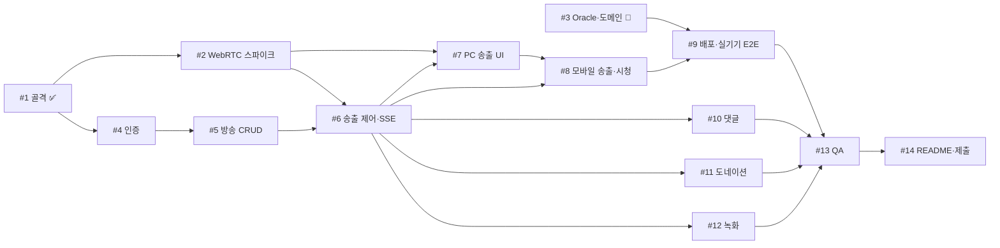

# 진행 순서와 이슈 의존 관계

마감: 2026-11-19 23:59. 각 이슈의 "Blocked by"는 GitHub 이슈 사이드바에도 등록되어 있습니다.

## 의존 그래프

🙋: 사용자가 직접 진행하는 이슈.

## 단계별로 동시에 할 수 있는 이슈

| 단계 | 동시 진행 가능 | 시작 조건 | 서버(#3) 필요 |
|---|---|---|---|
| W0 | **#2**, **#4**, #3 🙋 | 지금 바로 | 아니오 |
| W1 | **#5** | #4 완료 | 아니오 |
| W2 | **#6** | #2, #5 완료 | 아니오 |
| W3 | **#7**, #10, #11, #12 | #6 완료 (#7은 #2만 끝나도 UI 착수 가능) | 아니오 |
| W4 | **#8** | #7 완료 (WHIP 클라이언트 공용) | 아니오 (최종 실기기 확인은 #9) |
| W5 | **#9** | #3, #8 완료 | **예** |
| W6 | #13 → #14 | #9 완료 (테스트·README 초안은 미리 작성) | 예 |

- **굵게** 표시한 이슈가 크리티컬 패스입니다: #4 → #5 → #6 → #7 → #8 → #9. 여기가 밀리면 필수 기능 마감(11-12)이 밀립니다.
- #10, #11, #12는 서로 독립이라 순서를 바꿔도 됩니다. 필수 기능을 먼저 끝내기 위해 W3에서는 #7을 우선합니다.
- #3은 개발과 완전히 독립입니다. #9 시작 전(11-11)까지만 끝나면 됩니다.

## 서버 없이 확인할 수 없는 것
대부분은 로컬 `docker compose`로 확인할 수 있습니다. 서버가 있어야만 확인할 수 있는 것은 아래 셋뿐입니다.

1. **공인망(모바일 데이터)에서의 시청·송출**: NAT, 방화벽, ICE-TCP 폴백이 실제로 동작하는지 (#9)
2. **실제 도메인 인증서**: galle.cloud HTTPS 발급과 www 리다이렉트 (#3)
3. **토스 웹훅 수신**: 웹훅은 공인 URL이 필요합니다. 적립의 기준은 confirm 응답이라 웹훅은 보조 경로입니다 (#11)

휴대폰 카메라 송출은 HTTPS가 필요하지만, 서버 없이도 아래 방법으로 미리 시도할 수 있습니다 (#2, 확실하지 않음).
- 같은 Wi-Fi에서 `cloudflared` 임시 터널(계정 불필요)로 HTTPS 신호 경로를 만들고, 미디어는 PC의 LAN IP(`MEDIA_PUBLIC_HOST`)로 직접 연결합니다.
- 실패하면 #9에서 실기기로 확인합니다.

## 사용자가 미리 해둘 수 있는 일
- #3 Oracle 가입과 서버 세팅 ([INFRA_SETUP.md](INFRA_SETUP.md))
- 토스페이먼츠 개발자센터 가입과 테스트 키 발급 (#11에서 사용, 키는 `.env`에만 저장)
- 송출 테스트용 기기 준비: iPhone(Safari)과 Android(Chrome) 각 1대가 있으면 좋습니다
