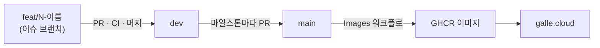

# 작업 흐름

2026-11-09부터 이슈 #5 이후의 개발은 아래 흐름으로 진행한다. 각 이슈의 실제 진행 기록과 판단 근거는 [WORKLOG.md](WORKLOG.md)에, 사용자 확인이 필요한 결정은 [QUESTIONS.md](QUESTIONS.md)에 남긴다.

## 브랜치와 배포

- 이슈마다 `dev`에서 브랜치를 만든다(`feat/5-broadcasts` 등). 서로 독립인 이슈(#10·#11·#12)는 git worktree로 나눠 동시에 진행한다.
- PR은 `dev`로 올리고, CI(typecheck·test·compose 검증)가 통과하면 머지한다. 이슈 브랜치의 커밋 기록을 남기기 위해 merge commit을 쓴다.
- `main`에 push되면 운영 배포가 된다. 그래서 `dev → main`은 실서버 확인이 필요한 시점에만 올린다.
  - 필수 기능 묶음(#5~#8)이 끝났을 때: #9 실기기 검증용
  - 선택 기능이 끝났을 때, 그리고 제출 직전

## 이슈 하나의 진행 순서

1. **착수**: 이슈 본문, DESIGN.md, 선행 이슈의 결과를 읽는다. 설계가 바뀌면 DESIGN.md를 먼저 고친다.
2. **구현과 백엔드 테스트**: 기능마다 `apps/api/test`에 통합 테스트(Fastify `inject`)를 함께 작성한다. 권한은 비로그인 / 다른 사용자 / 소유자 세 경우를 모두 검사한다.
3. **간단한 프론트**: 기능을 브라우저에서 직접 확인할 수 있는 최소 화면을 만든다. 디자인은 백엔드가 끝난 뒤 일괄로 입힌다.
4. **직접 테스트**: 로컬 `docker compose`(또는 dev 서버)를 띄우고 Playwright로 실제 화면을 조작해 시나리오를 확인한다. 미디어가 필요한 시나리오는 Chrome의 가짜 장치(`--use-fake-device-for-media-stream`)를 쓴다.
5. **코드 리뷰**: `/code-review`를 `dev` 기준으로 실행한다. 표준(코딩 관례·코드 냄새)과 명세(이슈·DESIGN.md) 두 축을 서로 다른 서브 에이전트가 검토한다.
6. **리뷰 반영**: 지적마다 고칠지 판단해 WORKLOG에 근거와 함께 남긴다. 고친 뒤 테스트를 다시 돌린다.
7. **PR과 머지**: PR 본문에 변경 요약, 테스트 결과, 리뷰 반영 내역, 명세 체크리스트 항목을 적는다. CI가 통과하면 머지하고 이슈를 닫는다.
8. **체크리스트 갱신**: [SPEC_CHECKLIST.md](SPEC_CHECKLIST.md)의 해당 항목에 근거(테스트 이름, 확인 시나리오)를 적는다.

## 판단 기준

| 상황 | 처리 |
|---|---|
| 추천안에 대한 확신이 80% 이상 | 그대로 진행하고 WORKLOG에 근거를 남긴다 |
| 확신이 80% 미만이거나 사용자 취향·비용·외부 계정이 걸린 결정 | 합리적인 기본값으로 진행하되 QUESTIONS.md에 질문으로 남긴다. 답을 받으면 반영한다 |
| 되돌리기 어렵거나 외부에 영향을 주는 작업 (데이터 삭제, 결제 실키 등) | 진행하지 않고 QUESTIONS.md에 남긴다 |

## 에이전트 활용

- 크리티컬 패스(#5 → #6 → #7 → #8)는 순서대로 진행한다. 앞 이슈의 API가 뒤 이슈의 전제다.
- #6이 끝나면 #10·#11·#12는 서로 독립이라 worktree를 나눠 서브 에이전트에게 맡길 수 있다. 각 에이전트에게는 이슈 본문, DESIGN.md 해당 절, 기존 코드 관례(에러 형식, 테스트 방식)를 전달한다.
- 코드 리뷰는 구현한 에이전트와 다른 에이전트가 맡는다. 구현자의 판단에 끌려가지 않기 위해서다.
- 에이전트가 만든 결과는 테스트와 직접 확인을 거친 뒤에만 머지한다.

## 사용성 원칙

- 모든 오류는 사용자가 다음에 무엇을 하면 되는지 알려준다 (예: "카메라 권한이 거부되었습니다. 주소창의 자물쇠 아이콘에서 허용하세요").
- 방송 상태(준비 / 방송 중 / 재연결 중 / 종료)는 송출자와 시청자 화면 모두에서 한눈에 보이게 한다.
- 모바일에서 한 손으로 조작할 수 있는 크기와 배치를 기본으로 한다.
- 비로그인 사용자가 로그인이 필요한 동작을 누르면 로그인 화면으로 보내고, 로그인 후 원래 화면으로 돌아온다.
